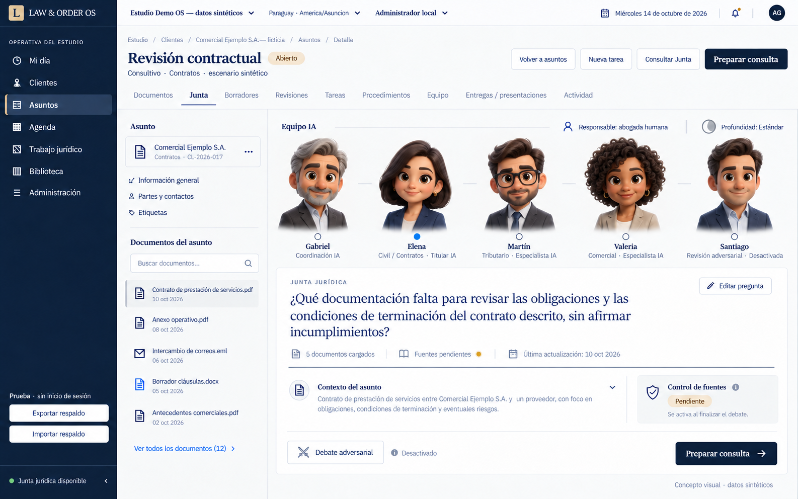
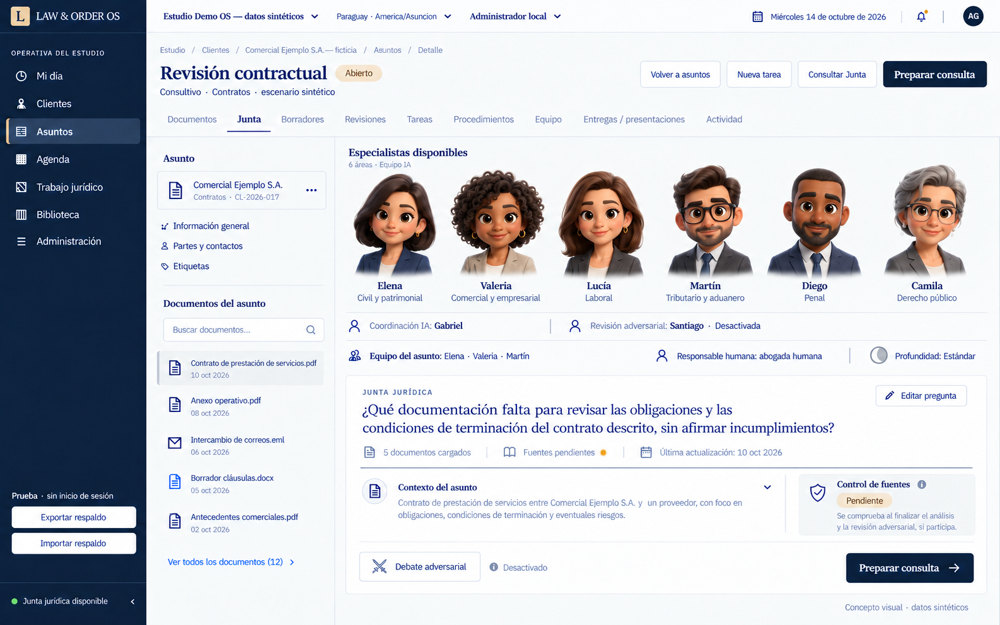

# Interfaz compacta con personajes humanos 3D tipo emoji

Actualización documental: 15/10/2026, America/Asuncion. Referencia de decisiones/handoff: 14/10/2026; propuestas aún sin aprobación funcional.

Estado: DIRECCIÓN VISUAL Y CATÁLOGO DE SEIS ÁREAS ACEPTADOS, 14/10/2026. La UI local posterior sí modificó TSX/CSS y agregó personajes/catálogo. El propietario rechazó su composición/jerarquía. Esta revisión modifica documentación; el nuevo recorrido funcional sigue pendiente del ADR.

## Reconciliación de navegación y función

El [handoff de continuación](HANDOFF_NEXT_CHAT_2026-10-14.md) supera las propuestas históricas que asimilan Mi día a Dashboard. Personajes aceptados; composición actual rechazada. Conservar seis PNG e identidades; no volver a seleccionar estilo ni producir otra pantalla por intuición.

| Espacio propuesto | Función y transición | Estados que debe distinguir |
|---|---|---|
| Dashboard | Orientación y entrada con Gabriel por texto; delimitar encargo → confirmar equipo propuesto → elegir/crear asunto por Core → abrir Equipo jurídico | Entrada vacía, coordinación no autorizada, delimitación, equipo propuesto, falta de especialidad, enlace pendiente/fallido |
| Mi día | Trabajo personal real del actor: tareas y revisiones; cada señal abre sus registros | Cargando, vacío confirmado, parcial/no disponible, atrasado, revisión pendiente. Sin catálogo permanente |
| Equipo jurídico del asunto | Titular/consultores del plan, pregunta y documentos; modificar equipo → autorizar análisis → aportes/debate → checker → revisión humana | Equipo confirmado sin ejecutar, evidencia incompleta, análisis autorizado, parcial, debate, fuentes pendientes/comprobadas en ámbito, versión desactualizada, revisión humana |

Son contratos de navegación/estado para el diseño posterior aprobado, no tres pantallas implementadas ni QA visual cerrado. «Equipo jurídico» reemplaza el rótulo público «Junta»; IDs, archivos y runs legacy pueden conservarse internamente. Junta completa permanece como acción/modalidad explícita dentro del espacio.

«Personas y permisos» distingue integrantes humanos/accesos de participantes IA. Solo titular/propuestos/invitados aparecen en el asunto; las seis áreas se exploran bajo «Agregar especialista». Cada seleccionado muestra encargo/aporte/estado real. Confirmar equipo no ejecuta ni cobra.

## KPI accionables y lectura autorizada

Máximo cuatro indicadores protagonistas, con alcance/período/zona/actualización y lista exacta detrás. Dashboard puede mostrar alcance personal hasta que exista agregado autorizado de estudio; no rotularlo global.

| Indicador | Definición propuesta | Dependencia real |
|---|---|---|
| Tareas internas atrasadas | PENDING, actor/ámbito autorizado y internal_due_at anterior a ahora | /my-day local entrega pendientes personales; no carga total del estudio |
| Pendientes para el resto de hoy | PENDING, internal_due_at desde ahora hasta próxima medianoche del estudio, sin incluir atrasadas | Zona America/Asuncion; no UTC truncada ni suma duplicada |
| Revisiones humanas pendientes | Revisión PENDING asignada al actor/ámbito y versión todavía vigente | Leer revisiones con permisos; task de revisión no se cuenta como aprobación |
| Borradores con cambios solicitados | Draft CHANGES_REQUESTED visible en ámbito declarado | Agregado de lectura todavía por diseñar; no derivarlo solo de /my-day |

Fecha interna no es plazo legal. Fechas inválidas/datos omitidos implican cobertura parcial, no cero. Carga «—»; error «No disponible»; cero solo tras consulta completa. El filtro del destino conserva los mismos IDs/corte del indicador; si cambió, mostrar actualización. No sumar tablas crudas del storage ni ampliar permisos para rellenar KPIs. No publicar ingresos, rentabilidad, éxito, ahorro o agentes activos sin datos verificables.

## Directiva más reciente del propietario

Durante la auditoría se agregó: «LA UI NECESITO QUE SEA SOBRIA PERO MODERNA… DASHBOARD, MODERNOS… el sistema agéntico representado por elementos 3d flotantes no como un cuadrado que diga tributario… queremos diferenciación… NO QUIERO AI SLOP».

Corrección posterior explícita del propietario: «la representación de los especialistas deben ser caracteres humanos… no debe aparecer el nombre del modelo, NUNCA».

Corrección más reciente del propietario: «hacelo 3d medio caricaturesco tipo emoji pero hyperrealista».

La representación vigente es un equipo de personajes humanos 3D tipo emoji, moderadamente caricaturescos, con acabado hiperrealista de materiales e iluminación. Rostros expresivos, cabeza algo grande y cuerpo compacto, vestimenta profesional e identidad reconocible. No retratos fotográficos. Ningún nombre de modelo/proveedor se muestra en el producto. El propietario adjuntó la primera imagen v3 e indicó que ese estilo estaba bien; después aceptó organizar el producto en seis grandes áreas mediante «esta bien... hacelo». Se adopta esa dirección, sin otra ronda de elección entre estilos. Se mantiene densidad, conservación del OS y aprobación del ADR antes de cambiar orquestación. Series anteriores con objetos simbólicos o personas de anatomía fotográfica quedan como historial.

## Base realmente inspeccionada

- `App.tsx`: sidebar/topbar, Mi día, cliente/asunto y tabs Documentos/Junta/Borradores/Revisiones/Tareas/Procedimientos/Equipo/Entregas/Actividad.
- `MatterJunta.tsx`: pregunta/documentos, consentimiento, buscar fuentes, consulta, actualización/histórico, fuentes y guardado de borrador.
- `JuntaDeliberation`, `JuntaLegalDocument`, `JuntaSources`, `JuntaReviewChecks`: componentes a evolucionar por composición.
- `styles.css`: raíz 13px, topbar 44px, sidebar 212px, filas 34px y controles 32px. La lectura jurídica tiene tratamiento editorial propio, más amplio que tablas; no debe contagiar tamaño a todos los controles.

Capturas históricas de la UI real antes de esta corrección, conservadas como evidencia y no como objetivo visual:

[Captura de baseline a 1366×768](reports/current-matter-1366.jpg)

[Captura de baseline a 1440×900](reports/current-matter-1440.jpg)

Observación del navegador a 1366×768: font 13px, zoom CSS 1, topbar 44px, sidebar 212px y sin desborde horizontal. El resultado histórico apareció por recuperación de lectura; no se cobró otra Junta. Capturas de lo existente no son capturas de especialistas implementados.

## Dirección de diseño

La diferenciación debe concentrarse en una zona espacial de trabajo y una tipografía/alineación cuidadas. Un escritorio jurídico actual: grafito/tinta, blanco mineral o platino, metal mate y acento medido. Evitar plantilla genérica de tarjetas, degradados púrpura, robot simpático, neón, efectos de vidrio repetidos o números gigantes sin utilidad.

Los agentes son personajes humanos adultos 3D con geometría caricaturesca tipo emoji: cabeza aproximadamente 1,6–1,8 veces mayor respecto del torso que en proporción natural, ojos y cejas expresivos, mejillas/nariz suavemente simplificadas y cuerpo compacto. El acabado es hiperrealista: piel con microtextura y dispersión de luz, pelo con volumen y fibras, tejido/costuras, reflejos de lentes e iluminación físicamente creíble. Anatomía estilizada y materiales realistas son requisitos simultáneos; no basta una foto de persona recortada ni un avatar plano. Expresiones maduras y sobrias, sin proporciones infantiles. Composición flotante con profundidad y sombras leves; busto/medio cuerpo según espacio. Diversidad de edad, género y rasgos sin estereotipos por especialidad. Coordinador, titular, invitados y revisor se distinguen por personaje, etiqueta textual y función; ninguna distinción depende solo del color. Sin cajas cuadradas individuales ni objetos abstractos como sustitutos del especialista.

Las etiquetas distinguen Equipo IA y responsable humano real. Personaje con aspecto humano no implica abogado real, matrícula ni credencial profesional. Los seis personajes base del catálogo son:

| Personaje | Área pública | Identidad visual del concepto |
|---|---|---|
| Elena | Civil y patrimonial | Pelo oscuro bob, blazer azul marino |
| Valeria | Comercial y empresarial | Piel morena, pelo corto rizado, blazer piedra |
| Lucía | Laboral | Pelo castaño hasta hombros, blazer grafito |
| Martín | Tributario y aduanero | Pelo oscuro, gafas negras, traje grafito |
| Diego | Penal | Piel morena, pelo muy corto, barba corta, blazer azul marino |
| Camila | Derecho público | Pelo recogido con canas, gafas finas, blazer pizarra |

Gabriel (coordinación) y Santiago (revisión adversarial opcional) son funciones de apoyo separadas y no forman parte del conteo de seis especialidades. Se reutilizan sus identidades visuales de la referencia. Los nombres son ficticios, sin credenciales profesionales humanas; los nuevos personajes extienden la misma familia artística.

El directorio/selector explícito presenta las seis áreas. Cerrado el selector, el asunto muestra solamente su titular y los invitados: nunca se convoca a todos por abrir una consulta. Los subperfiles de cada rama se eligen en detalle, sin añadir personajes a la barra. Cambiar de subperfil conserva el personaje y exige alcance/fuentes/evaluación propios.

## Regla absoluta de presentación

NUNCA mostrar nombres, aliases, versiones ni marcas de modelos/proveedores en pantallas, navegación, selectores, estados, historial, nombres de agentes, tooltips, texto alternativo/ARIA, mensajes de error, costos, descargas o informes visibles al usuario. Tampoco en una sección «avanzada» del producto.

Vocabulario público: «Profundidad: Estándar / Análisis profundo», «Revisión adversarial», «Coordinación IA», «Especialista IA», «Control de fuentes», «Revisión humana». El costo se atribuye al personaje/rol y encargo. Los dos niveles de profundidad conservan autorización manual y presupuesto; cambiar personaje o seleccionar su retrato no modifica potencia ni ejecuta llamadas.

Identificadores técnicos efectivos permanecen en configuración, persistencia y registros internos de auditoría necesarios para trazabilidad. Se proyectan a un DTO público de persona/función, sin exponerlos a componentes o exports. Esta separación no elimina evidencia técnica ni permite ocultar uso/costo real. Los documentos técnicos de arquitectura conservan esos identificadores fuera de la interfaz del producto.

Las exploraciones visuales basadas en la captura actual y el diagrama funcional son imágenes conceptuales, no frontend ni captura de producción. La primera opción v3 queda seleccionada como referencia y se adapta al catálogo aprobado. Convertirla en componentes sigue sujeto al alcance de implementación/ADR aplicable. Las imágenes pueden contener aproximaciones de texto o ejemplos de documentos; requieren corrección determinística antes de implementación.

Referencia visual seleccionada: primera imagen de la serie v3, adjuntada por el propietario. Las demás variantes se conservan como historial; ya no se solicita volver a elegir una dirección.

Adaptación vigente de esa misma dirección al catálogo de seis áreas, con selector abierto y equipo del asunto identificado aparte. Coordinación/revisión permanecen fuera del conteo de especialidades:

QA pendiente de estas maquetas: ajustar tamaños de títulos/personajes a densidad real, eliminar duplicaciones de acciones o controles, corregir conteos/textos ficticios y adaptar todas las funciones al código existente. Los PDFs/formatos que aparecen como datos de ejemplo en las imágenes no acreditan soporte de carga del prototipo, que hoy limita la consulta privada a TXT. La adaptación seleccionada usa franja superior; debe respetar el presupuesto de espacio de trabajo al implementarse.

## Composición propuesta

| Zona | Contrato visual/funcional |
|---|---|
| Shell | Añadir Dashboard separado y conservar Mi día/contexto del asunto; topbar contenida, iconos de una biblioteca consistente con texto. Biblioteca de iconos aún por elegir/instalar |
| Cabecera | Título 19–22px, responsable HUMANO y titular IA separados; estado real y sin hero/banner |
| Equipo contextual | Fila compacta de participantes/nombres/roles/estado; detalles progresivos. No reservar franja permanente de seis retratos ni desplazar pregunta/documentos. Selector de seis solo bajo Agregar especialista |
| Consulta | Pregunta y evidencia dominan. Editor/documentos reutilizados; no chats independientes por especialista |
| Controles | Profundidad Estándar/Análisis profundo por perfil y encargo, revisión adversarial optativa, convocar/quitar y presupuesto visible; acción primaria única |
| Evidencia | Fuentes recuperadas, texto entregado/citado, cotejo pendiente y límites; detalles progresivos, sin dashboard de contadores decorativos |
| Trabajo/resultado | Lista/tablas densas e informe legible; disensos y referencias pendientes accesibles dentro del asunto |
| Revisión | Control bibliográfico terminal y aprobación humana separados; no check verde de certeza jurídica |

Dashboard y Mi día permanecen separados. El primero orienta/inicia encargos; el segundo organiza trabajo personal. No usar avatares o indicadores inventados para completar la composición. El siguiente diseño visual requiere tres pantallas conectadas y estados según este contrato, una vez aprobado el ADR funcional.

## Semántica de interacción

Seleccionar personaje abre detalles del perfil/aporte, nunca dispara gasto. Hover/focus puede mostrar alcance/fuentes y estado. Coordinador permite revisar plan; titular muestra su encargo; invitados sus opiniones; revisor adversarial sus objeciones/réplicas. El grafo visual diferencia convocatoria de flujo temporal: Civil→Tributario→Comercial no es una cadena obligatoria.

La flotación puede ser una composición estática con interacción breve de inclinación/elevación. Evitar movimiento perpetuo distractor. Estado RUNNING deriva del job real, no de una animación por tiempo estimado. Fuente pendiente no se representa como verificada por completar animación. `prefers-reduced-motion` elimina movimiento; fallback estático mantiene función y semántica.

Personajes tipo emoji 3D necesitan assets originales creados/renderizados, anatomía estilizada, acabado hiperrealista y coherencia de identidad. No sustituirlos por glifos emoji Unicode agrandados, fotografías, íconos planos ni siluetas geométricas. Elegir raster/GLB según rendimiento y uso después de seleccionar dirección; no agregar WebGL pesado a cada fila. Carga diferida, recursos reutilizados, pausa fuera de vista y fallback estático del mismo personaje; medir rendimiento antes de prometer fluidez.

Coordinador no necesita personaje más dominante que el responsable humano. Análisis profundo es capacidad del mismo especialista y conserva su personaje/nombre; no crea otra persona. Revisor adversarial apagado debe ser distinguible; control de fuentes se muestra como estado terminal, no otro abogado deliberante.

## Hover, foco e iconos

Todas las cards/KPI accionables tienen hover visible y foco de teclado equivalente: borde/fondo/elevación contenidos. No hacer parecer clickable un bloque estático. El rollback de un pedido viejo de iluminación no anula el pedido posterior de hover para todos los KPI/cards. Mantener contraste, reduced-motion y ausencia de halos globales.

Sustituir glifos Unicode ilegibles por una sola familia de iconos con tamaño/trazo consistente y etiquetas. Phosphor fue propuesto, no está instalado ni aprobado como dependencia definitiva. Este documento no instala nada.

## Voz pendiente de contrato

Texto es el recorrido completo inicial. Voz requiere acción explícita, indicador de grabación, detener/cancelar, transcripción editable confirmada y alternativa textual. Antes de habilitar: verificar navegador real (Firefox reportado), procesamiento local/remoto, terceros, datos permitidos, retención/borrado, límites y costo. Permiso de micrófono no autoriza transmisión ni inferencia jurídica. No mostrar un micrófono decorativo o prometer compatibilidad universal.

## Estados mínimos

Sin titular / propuesta pendiente; titular confirmado; equipo sin costo aprobado; evidencia incompleta; listo para consulta; ejecución parcial; debate desactivado/en curso/cerrado; control de fuentes pendiente/en revisión/comprobado en ámbito; cero citas; evidencia desactualizada; revisión humana pendiente/aprobada para versión exacta. Redactar estados y detalles en lenguaje del abogado, sin nombres de motores ni códigos de proveedor.

## QA y aceptación visual pendiente

1440×900 y 1366×768 al 100%, zoom CSS 1, sin scroll horizontal, controles accesibles por teclado/nombre/focus. El área 3D no desplaza evidencia o trabajo operativo por debajo de varias pantallas. La densidad de filas/controles se conserva donde aplica; el texto jurídico conserva longitud de línea cómoda.

Pruebas: Dashboard separado de Mi día; KPI abre exactamente su conjunto autorizado, sin falso cero; hover/foco de cada card/KPI accionable; confirmación de equipo no cobra; enlace a Matter falla sin perder borrador; selector contiene exactamente seis áreas y excluye coordinación/revisión del conteo; vista normal solo contiene titular/invitados; subperfil no crea personaje nuevo; personaje seleccionado identifica perfil real; estados se basan en backend; costo/consentimiento legible antes de ejecutar; cambios de equipo invalidan plan; avatar nunca llama proveedor; reducción de movimiento; assets fallidos y red lenta; textos largos/especialidades sin cortar; contraste y foco visibles. La versión compacta puede plegar equipo en una fila de pequeños personajes con nombres, manteniendo identidad y función.

Gate de vocabulario: examinar todo DOM visible, árbol accesible, tooltips, estados de configuración/error/historial/costo y contenido exportado; cero nombres/versiones de modelos o proveedores. Inspección visual adicional de todo texto horneado en assets. Un error remoto no se muestra sin sanitización. Identidad visual estable al cambiar profundidad. Etiquetas Equipo IA/responsable humano inequívocas.

Gate de estilo: cada agente se reconoce inequívocamente como personaje humano 3D caricaturesco tipo emoji, con cabeza/rasgos estilizados y acabado hiperrealista; rechazar retratos de anatomía fotográfica, recortes de fotos o emojis planos. Toda la plantilla conserva proporciones/materiales/iluminación coherentes y sigue siendo compacta.

DONE visual: selección humana de dirección, activos originales coherentes, componentes renderizados reales en ambos tamaños, interacción/teclado/estados probados, comparación contra imagen seleccionada y ausencia de efectos decorativos que dificulten trabajar. La generación de maquetas por sí sola no alcanza este DONE.
